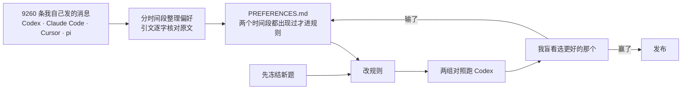
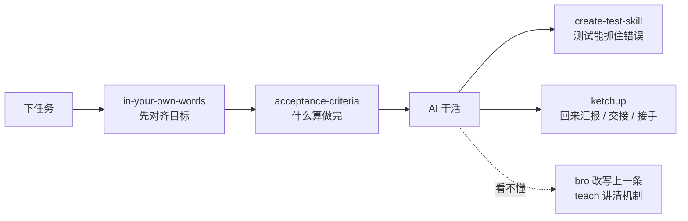

<div align="center">

# ytstack

**让 GPT 说人话，先定好什么算做完再动手。**

一套个人技能包，专为 Codex 的 GPT 模型（`gpt-6.1-sol`、`gpt-6-astra`）调试，同一份源码也能给 Claude Code 用。


</div>

---

## 为什么做这个

GPT 写代码很强，但回答经常读不懂：

- 满屏机制名，比如“写入不是原子的”“有丢更新风险”“收敛”“链路”；
- 写得很长，真正要你拍板的事藏在中间；
- 说“本仓库”“该工具”，让你猜指的是哪个；
- 单测一过就说“已完成”，没有真跑过。

每次都要追一句“说人话”。ytstack 的做法是让它第一遍就写对。

| GPT 默认会写 | 装了 ytstack 之后 |
| --- | --- |
| 写入不是原子的 | 保存到一半程序挂了，原来的内容也可能坏掉 |
| 用原子替换 | 先写到新文件，写完再替换旧文件 |
| 有丢更新风险 | 两个人同时保存，后保存的会盖掉先保存的 |
| 校验哈希 | 用文件内容的指纹，判断它有没有被改过 |
| 已完成 ✅ | 实际跑了哪条命令、看到了什么结果，证据在哪个文件 |

## 规则从哪来

规则不是凭感觉写的。每条都能追溯到 [voice/PREFERENCES.md](voice/PREFERENCES.md)，那里记着我真实说过的话，以及它在哪几个时间段出现过。



- **先冻结题目再改规则。** 题目文件的指纹单独提交，旧题不能再用。
- **好不好由我的盲看说了算。** 模型评委多次和我的判断不一致，只作参考。
- **每轮 4 到 8 题。** 两组随机标成甲、乙，揭盲之前我不知道哪个是新版。

## 里面有什么

### 🗣 常驻规则：每轮都生效

[`voice/plain-talk.md`](voice/plain-talk.md) 写进项目的 `AGENTS.md`（Claude Code 是 `CLAUDE.md`），管 AI 每一轮怎么跟你说话：

- 汇报先给不超过 10 行的人话摘要；决策类问题约 400 字。
- 说后果和做法，不说机制的名字。
- 写短时删罗列，不删理由。
- 说清指的是哪个文件、哪个目录。

### 🧩 技能：说到相关的事才加载

| | 技能 | 什么时候用 | 做什么 |
| --- | --- | --- | --- |
| 💬 | `in-your-own-words` | 点名 `$in-your-own-words` | 分条复述你的目标和要解决的问题，猜测单独标出来，然后停下等你确认 |
| 💬 | `bro` | “说人话”“我没太明白” | 把上一条回答改写成人话，结论、数字、前提一个不丢 |
| 💬 | `ketchup` | “我回来了”“写交接说明”“接着上次的工作” | 回来时只汇报、不写文件；写一份能照着做的交接说明；接手时先核对写成“已完成”的事 |
| 💬 | `teach` | “把我当小白讲讲 X” | 自己读代码和提交记录来讲；讲原因时分清有原文、推断还是查不到 |
| ✅ | `acceptance-criteria` | “先定验收标准” | 动手前写一份连贯的短标准：每条靠什么证据算通过，最后列出要你拍板的决定 |
| ✅ | `create-test-skill` | “给这个项目生成测试技能” | 生成可重复运行的行为测试，并实际证明它能抓住一次错误 |
| 📝 | `technical-bro` | 写文档、PR、提交说明 | 按 technical-writing 的四层规范写 |
| 📝 | `unslop` | 随包依赖 | 清理空话和套路表达，`teach` 和 `technical-bro` 会用到 |

它们在一次任务里的位置：



## 快速开始

把仓库克隆到工作区，再装到目标项目里（目标项目要已经存在）。

**Codex**

```sh
git clone https://github.com/ytian9405/ytstack.git
python3 ytstack/tools/install.py --project /path/to/project --harness codex --voice
```

- `--voice` 会把常驻规则写进项目的 `AGENTS.md`，放在一对标记之间。标记外的内容不动，再次运行只更新标记内的内容。
- 技能装在项目的 `.agents/skills/` 下。装完重新开一个会话，就能用 `$ketchup`、`$teach` 等调用，也可以直接用自然语言说。

**Claude Code**

```sh
claude --plugin-dir ./ytstack          # 直接当插件加载，调用名如 /ytstack:teach
python3 ytstack/tools/install.py --project /path/to/project --harness claude --voice
```

**常用选项**

| 选项 | 作用 |
| --- | --- |
| `--skill teach` | 只装一个技能，它的依赖会一起装上 |
| `--method copy` | 复制文件，不建软链接；源码移动后不受影响 |
| `--dry-run` | 只显示会做什么，不真的装 |

项目里已有同名但内容不同的技能时，安装器保留原文件并报冲突，不会覆盖。

## 你可以这样说

```text
$in-your-own-words 我想把队列和账本对上，你先用你的话说说我要干嘛。
给 expense 工具加撤销功能，开发前先把验收标准定下来。
我回来了，现在什么情况？有什么要我定的？
我要换到另一台电脑接着弄，帮我写交接说明。
把我当小白，讲讲下一条任务是怎么挑出来的。
bro，上一条没看懂，说人话。
```

## 评测记录

每一轮都是：先冻结题目，再改规则，跑两组对照，最后我盲看。完整题目、原始输出和报告都在 [`evaluation/`](evaluation/)。

| 轮次 | 比了什么 | 盲看结果 |
| --- | --- | --- |
| [v0.3](evaluation/v03/REPORT.md) | 说人话 v0.3 对 v0.2 | 3 : 3 平 |
| [v0.4](evaluation/v04/REPORT.md) | 按偏好重写说人话和验收标准 | 验收标准 2 题都选新版；说人话 2 : 2 平 |
| [v0.5](evaluation/v05/REPORT.md) | 验收标准 v0.5、说人话 v0.5 | 验收标准 1 胜 1 平，保留；说人话 1 胜 3 负，退回 v0.4 再补 4 条 |
| [v07](evaluation/v07/REPORT.md) | 装与不装三个沟通技能 | 4 胜 3 负 |
| [v08](evaluation/v08/REPORT.md) | 修好 v07 输掉的三处 | **6 : 0** |

> [!NOTE]
> 现在的说人话规则是 v0.4 加 4 条新偏好，这一版还没单独盲看过。每轮只看 4 到 8 题，样本小，结论供参考。

## 检查

只需要 Python 3.9+ 标准库：

```sh
python3 ytstack/tools/validate.py                   # 包结构、依赖、上游原文指纹
python3 -m unittest discover -s ytstack/tests -v    # 安装器回归测试
claude plugin validate ./ytstack                    # 需要本机装了 Claude CLI
```

这些只检查文件和安装是否正确，模型行为好不好看上面的评测记录。

## 目录

```text
skills/        八个技能，每个一个目录
voice/         常驻说话规则 plain-talk.md，以及规则依据 PREFERENCES.md
tools/         安装器 install.py、检查器 validate.py
evaluation/    每一轮评测的题目、原始输出、盲看页和报告
tests/         安装器和包结构的回归测试
```

## 来源与许可

ytstack 借鉴了 Cursor 的 [pstack](https://github.com/cursor/plugins/tree/main/pstack)（作者 Lauren Tan，MIT 许可）：

- `bro`、`unslop`、`technical-bro` 保留上游原文，后面加了中文规则。
- `ketchup`、`teach`、`in-your-own-words`、`create-test-skill` 借用上游的做法，用中文重写。

每个文件的来源、上游指纹和改动范围记录在 [NOTICE.md](NOTICE.md) 和 [`provenance.json`](provenance.json)。本包不装全局技能，不带总路由器、模型配置或自动启动的 hooks。

MIT License · 见 [LICENSE](LICENSE)
