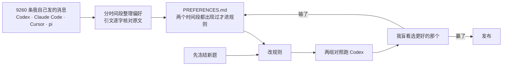
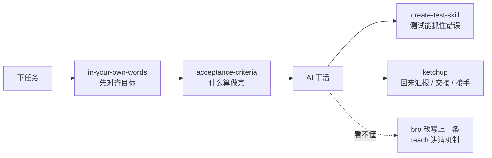

<div align="center">

# ytstack

**让 GPT 说人话，先定好什么算做完再动手。**

一套给 Codex 和 Claude Code 用的技能文件和常驻说话规则，专门对付 GPT 回答里满是黑话、看不懂的问题。<br/>
装法：克隆后运行 `tools/install.py`，见[快速开始](#快速开始)。

*Skills and always-on rules that make GPT models in Codex answer in plain Chinese and agree on acceptance criteria before writing code.*

    

</div>

## GPT 写代码很强，回答却常常读不懂

Codex 里的 GPT 模型（`gpt-6.1-sol`、`gpt-6-astra`）常见这几种毛病：

- 满屏机制名，比如“写入不是原子的”“有丢更新风险”。
- 写得很长，要你拍板的事藏在中间。
- 写“本仓库”“该工具”，让你猜指的是本机目录还是远端仓库。
- 单元测试一过就说“已完成”，没有真的跑过。

以前每次都要追一句“说人话”。ytstack 让它第一遍就写对：

| GPT 默认会写 | 装了 ytstack 之后 |
| --- | --- |
| 写入不是原子的 | 保存到一半程序挂了，原来的内容也可能坏掉 |
| 用原子替换 | 先写到新文件，写完再替换旧文件 |
| 有丢更新风险 | 两个人同时保存，后保存的会盖掉先保存的 |
| 校验哈希 | 用文件内容的指纹，判断它有没有被改过 |
| 已完成 | 实际跑了哪条命令、看到了什么结果，证据在哪个文件 |

## 每条规则都来自我说过的话

规则的依据写在 [voice/PREFERENCES.md](voice/PREFERENCES.md)。里面记着我的原话，以及它在哪几个时间段出现过。



- 每轮 4 到 8 题，先冻结再改规则。题目文件的指纹单独提交，旧题不再用。
- 好不好由我盲看决定。模型评委多次和我的判断不一致，只作参考。
- 两组随机标成甲、乙，揭盲前我不知道哪个是新版。

## 装上后有什么

### 常驻规则，每一轮对话都生效

[`voice/plain-talk.md`](voice/plain-talk.md) 写进项目或全局的 `AGENTS.md`（Claude Code 是 `CLAUDE.md`），规定 AI 怎么跟你说话：

- 汇报先给不超过 10 行的人话摘要。决策类问题约 400 字。
- 说后果和做法，不说机制的名字。
- 写短时删罗列，不删理由。
- 说清指的是哪个文件、哪个目录。

### 八个技能，说到相关的事才加载

| 技能 | 什么时候用 | 做什么 |
| --- | --- | --- |
| `in-your-own-words` | 只能你点名，比如 `$in-your-own-words` | 分条复述你的目标，猜测单独标出，然后停下等你确认 |
| `bro` | “说人话”“我没太明白” | 把上一条回答改写成人话，结论、数字、前提一个不丢 |
| `ketchup` | “我回来了”“写交接说明”“接着上次的工作” | 回来时只汇报不写文件；写能照着做的交接说明；接手时先核对写成“已完成”的事 |
| `teach` | “把我当小白讲讲 X” | 自己读代码和提交记录来讲，讲原因时分清有原文、推断还是查不到 |
| `acceptance-criteria` | “先定验收标准” | 动手前写一份短标准，每条靠什么证据算通过，最后列出要你拍板的事 |
| `create-test-skill` | “给这个项目生成测试技能” | 生成能反复运行的行为测试，并证明它能抓住一次错误 |
| `technical-bro` | 写文档、PR、提交说明 | 按四层技术写作规范写 |
| `unslop` | 被 `teach` 和 `technical-bro` 调用 | 删掉空话和套路表达 |

一次任务里，这些技能按下面的顺序出场：



## 快速开始

先克隆到本机。下面的命令都在运行 `git clone` 的那个目录里执行，不要 `cd` 进 `ytstack`。

```sh
git clone https://github.com/ytian9405/ytstack.git
```

### 装到所有项目

技能对本机每个项目都生效。Codex 读 `~/.agents/skills`，Claude Code 读 `~/.claude/skills`。

```sh
python3 ytstack/tools/install.py --project ~ --harness codex
python3 ytstack/tools/install.py --project ~ --harness claude
```

常驻规则要用下面的命令单独写进全局规则文件。不要用 `--voice`，它会写到 `~/AGENTS.md`，Codex 不读这个文件。

```sh
mkdir -p "${CODEX_HOME:-$HOME/.codex}" ~/.claude
PYTHONPATH=ytstack/tools python3 -c "import install, os; from pathlib import Path; install.install_voice(Path(os.environ.get('CODEX_HOME', Path.home()/'.codex')), 'codex')"
PYTHONPATH=ytstack/tools python3 -c "import install; from pathlib import Path; install.install_voice(Path.home()/'.claude', 'claude')"
```

- 如果 Codex 是通过 Orca 启动的，`CODEX_HOME` 可能指向 Orca 给每个账户单独建的目录。请在那个终端里运行上面的 Codex 命令，规则才会写进它实际读取的文件。
- 命令不打印内容。打开对应文件，看到 `<!-- ytstack:plain-talk:begin -->` 就说明写进去了。
- 技能用的是链接，`git pull` 之后自动更新。常驻规则是复制进去的，规则更新后要重新运行写规则的命令。

### 只装到一个项目

目标项目要已经存在。技能装到项目的 `.agents/skills/`，Claude Code 是 `.claude/skills/`。

```sh
python3 ytstack/tools/install.py --project /path/to/project --harness codex --voice
python3 ytstack/tools/install.py --project /path/to/project --harness claude --voice
```

- `--voice` 把常驻规则写进项目的 `AGENTS.md` 或 `CLAUDE.md`，放在一对标记之间。标记外的内容不动，再次运行只更新标记内的部分。
- 装完重新开一个会话。技能可以直接用自然语言说，也可以点名：Codex 用 `$teach`，Claude Code 用 `/teach`。
- Claude Code 也能直接把仓库当插件加载：`claude --plugin-dir ./ytstack`，调用名带前缀，比如 `/ytstack:teach`。

两种装法都能加这些选项，遇到冲突时的处理也相同：

- `--skill teach`：只装一个技能和它依赖的技能。
- `--method copy`：复制文件，不建链接。之后 `git pull` 不会更新它。
- `--dry-run`：只显示会做什么。
- 目标位置已有同名但内容不同的技能时，安装器保留原文件并报冲突，不会覆盖。

## 你可以这样说

```text
$in-your-own-words 我想把队列和账本对上，你先用你的话说说我要干嘛。
给 expense 工具加撤销功能，开发前先把验收标准定下来。
我回来了，现在什么情况？有什么要我定的？
我要换到另一台电脑接着弄，帮我写交接说明。
把我当小白，讲讲下一条任务是怎么挑出来的。
bro，上一条没看懂，说人话。
```

## 评测记录

每一轮的题目、原始输出和报告都在 [`evaluation/`](evaluation/)。

| 轮次 | 比了什么 | 盲看结果 |
| --- | --- | --- |
| [`v03`](evaluation/v03/REPORT.md) | 说人话 v0.3 对 v0.2；新写法的验收标准对改动前 | 说人话 3 : 3 平；验收标准两轮 4 题，新版 3 负 1 平 |
| [`v04`](evaluation/v04/REPORT.md) | 按偏好重写说人话和验收标准 | 验收标准 2 题都选新版；说人话 2 : 2 平 |
| [`v05`](evaluation/v05/REPORT.md) | 验收标准 v0.5、说人话 v0.5 | 验收标准 1 胜 1 平，保留；说人话 1 胜 3 负，没采用 |
| [`v07`](evaluation/v07/REPORT.md) | 装与不装 `in-your-own-words`、`ketchup`、`teach` | 4 胜 3 负 |
| [`v08`](evaluation/v08/REPORT.md) | 修好 `v07` 输掉的三处 | **6 : 0** |
| [`v09`](evaluation/v09/REPORT.md) | `unslop` 加四条中文规则 | 1 胜 4 负 1 平，没采用 |

> [!NOTE]
> 现在的说人话规则是 v0.4 加 4 条新偏好，这一版还没单独盲看过。每轮样本小，结论供参考。

## 检查安装是否正确

这些命令只检查文件和安装，模型回答得好不好看上面的评测记录。只需要 Python 3.9 以上的标准库：

```sh
python3 ytstack/tools/validate.py                   # 目录结构、技能依赖、上游原文指纹
python3 -m unittest discover -s ytstack/tests -v    # 安装器回归测试
claude plugin validate ./ytstack                    # 需要本机装了 Claude CLI
```

## 来源与许可

ytstack 借鉴了 Cursor 的 [pstack](https://github.com/cursor/plugins/tree/main/pstack)（作者 Lauren Tan，MIT 许可）：

- `bro`、`unslop`、`technical-bro` 保留上游原文，后面加了中文规则。
- `ketchup`、`teach`、`in-your-own-words`、`create-test-skill` 借用上游的做法，用中文重写。

每个文件的来源、上游指纹和改动范围记录在 [NOTICE.md](NOTICE.md) 和 [`provenance.json`](provenance.json)。ytstack 不改模型设置，也不带会自动运行的脚本。许可证是 MIT，见 [LICENSE](LICENSE)。
